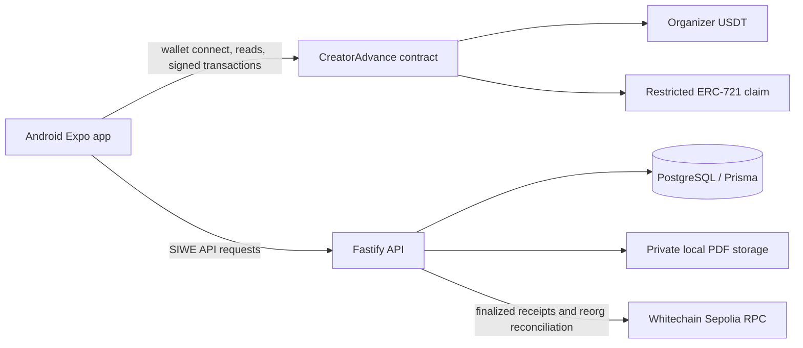
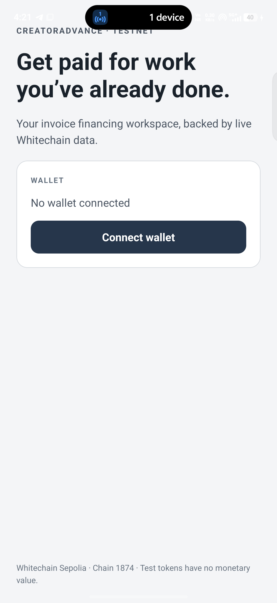

# CreatorAdvance

**Get paid today for work you've already completed.** CreatorAdvance is an Android-first prototype for financing creator receivables with sponsor USDT on Whitechain Sepolia.

> **Current status:** The contract, API, and Android client are implemented and pass local verification. The contract is not deployed, no sponsor USDT lifecycle transaction has been sent, and the app is not yet ready for a live financing demo. Do not treat this prototype as legal, financial, or production software.

## What it does

A creator selects a verified business, submits evidence for a completed payable, and requests an onchain brand signer to confirm it. An approved investor can offer USDT; accepting an offer atomically pays the creator and mints a transfer-restricted receivable claim. Repayments follow the current claim owner. After maturity plus the contract grace period, the contract applies available brand collateral and records any shortfall. Business verification, invoice authenticity, legal assignment, investor eligibility policy, and offchain recovery remain trust assumptions.

## System layout



See [architecture](docs/ARCHITECTURE.md), [product specification](docs/PRODUCT_SPEC.md), [security notes](docs/SECURITY.md), and [dependency verification](docs/DEPENDENCIES.md).



## Network and contract status

| Item | Value |
| --- | --- |
| Network | Whitechain Sepolia, chain ID `1874` (`0x752`) |
| RPC | `https://rpc.testnet.whitechain.io` |
| Explorer | `https://explorer.testnet.whitechain.io` |
| Organizer USDT | `0xcedfB56113143d55b2358b8CFbB0dEB5Ad2f55a7` (6 decimals) |
| CreatorAdvance contract | Not deployed; app contract address remains unset |
| Test wallet | `0x93bcA2E3811331Fb6e1D39B14166dC065BFCDcA1` |

The test wallet has 2 WBT for gas and currently 0 sponsor USDT. Its key is DPAPI encrypted outside this repository. Never send mainnet assets to it. The deployment requires explicit owner authorization; details and a read-only gas estimate are in [deployment preflight](docs/DEPLOYMENT_PREFLIGHT.md).

## Local development

Requirements: Node.js 22, pnpm 10, Java 17, Android SDK/ADB, PostgreSQL 18, and Foundry. Install dependencies with `pnpm install`.

1. Configure the Android app environment in `apps/mobile/.env.local`. Copy the variable names from `.env.example`; set `EXPO_PUBLIC_REOWN_PROJECT_ID`, API URL, and only set `EXPO_PUBLIC_CONTRACT_ADDRESS` after an approved deployment.
2. Configure `apps/api/.env` with `DATABASE_URL`, `APP_ORIGIN`, `PLATFORM_ADMIN_WALLETS`, and a private `PRIVATE_DOCUMENT_DIR`. `.env` is ignored by Git. Admin addresses are local test wallets and should never be end-user controlled in a real deployment.
3. Apply Prisma migrations with `pnpm --filter @creatoradvance/api db:migrate` and generate the client with `pnpm --filter @creatoradvance/api db:generate`.
4. Run the API with `pnpm --filter @creatoradvance/api dev`.
5. Build/install the Android development client with `pnpm --filter @creatoradvance/mobile android`; start Metro with `pnpm --filter @creatoradvance/mobile android:dev`.

The mobile app uses an external wallet through Reown. Wallet connection, SIWE, and transaction confirmations require user approval on the phone. A debug APK built from this workspace is at `apps/mobile/android/app/build/outputs/apk/debug/app-debug.apk` (local build artifact, not checked in).

## Checks

```powershell
pnpm typecheck
pnpm lint
pnpm test
pnpm build
```

The mobile build script exports the Android JavaScript bundle; the native debug APK uses Gradle from `apps/mobile/android`:

```powershell
Set-Location apps/mobile/android
.\gradlew.bat app:assembleDebug --configure-on-demand --build-cache -PreactNativeDevServerPort=8081 -PreactNativeArchitectures=arm64-v8a
```

Run Solidity checks in WSL from `contracts/` with `~/.foundry/bin/forge fmt --check` and `~/.foundry/bin/forge test -vvv`.

## Demo and release readiness

- [2–4 minute demo script](docs/DEMO_SCRIPT.md) is a plan, not a recording; live onchain steps remain pending deployment, test USDT funding, and wallet approvals.
- [Whitechain feedback](WHITECHAIN_FEEDBACK.md) records observed tooling friction and open funding/deadline checks.
- [AI usage disclosure](AI_USAGE.md) describes how AI assistance was used.
- [Android screenshot](docs/screenshots/android-home.png) shows the installed wallet-connect screen; it is not evidence of an authenticated or financed session.
- [Progress](PROGRESS.md), [blockers](docs/BLOCKERS.md), and [test plan](docs/TEST_PLAN.md) track verified work and gates.
- The repository has not been confirmed public and has not been pushed for release. No explorer transaction links exist yet.

## Why settle on Whitechain

The financing requires stablecoin settlement and claim ownership to change together. A single contract transaction can release organizer USDT to the creator while minting the claim to the investor, and the contract restricts claim transfers to approved investors. An ordinary bank transfer does not provide that atomic settlement and publicly verifiable ownership rule. The app still relies on offchain business verification and enforceable legal assignment.

## License

MIT; see [LICENSE](LICENSE).
