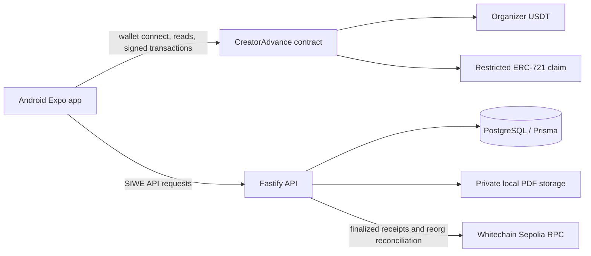

# CreatorAdvance

**Get paid today for work you've already completed.** CreatorAdvance is an Android-first prototype for financing creator receivables with sponsor USDT on Whitechain Sepolia.

> **Current status (2026-11-07):** CreatorAdvance is deployed on Whitechain Sepolia and the issuance-to-funding lifecycle completed with separate brand, creator, and investor wallets. The investor escrowed 4.8 organizer USDT; the creator's successful acceptance paid 4.8 USDT and minted the receivable claim to the investor. The contract source is not yet verified on the explorer. Repayment/default have not been exercised live. This is a testnet prototype, not legal, financial, or production software.

## What it does

A creator selects a verified business, submits evidence for a completed payable, and requests an onchain brand signer to confirm it. An approved investor can offer USDT; accepting an offer atomically pays the creator and mints a transfer-restricted receivable claim. Repayments follow the current claim owner. After maturity plus the contract grace period, the contract applies available brand collateral and records any shortfall. Business verification, invoice authenticity, legal assignment, investor eligibility policy, and offchain recovery remain trust assumptions.

## System layout



See [architecture](docs/ARCHITECTURE.md), [product specification](docs/PRODUCT_SPEC.md), [security notes](docs/SECURITY.md), and [dependency verification](docs/DEPENDENCIES.md).


## Network and contract status

| Item | Value |
| --- | --- |
| Network | Whitechain Sepolia, chain ID `1874` (`0x752`) |
| RPC | `https://rpc.testnet.whitechain.io` |
| Explorer | `https://explorer.testnet.whitechain.io` |
| Organizer USDT | `0xcedfB56113143d55b2358b8CFbB0dEB5Ad2f55a7` (6 decimals) |
| CreatorAdvance contract | [`0x598c4fb5aeb0f2965782a73c40972ecb8056e7fa`](https://explorer.testnet.whitechain.io/address/0x598c4fb5aeb0f2965782a73c40972ecb8056e7fa) (deployed; source verification pending) |
| Deployment transaction | [`0x40bbda02613989298422d4517aa5987204549254e3806e8e1dc0490501f06384`](https://explorer.testnet.whitechain.io/tx/0x40bbda02613989298422d4517aa5987204549254e3806e8e1dc0490501f06384) (Whitechain Sepolia) |
| Deployment wallet | User's connected MetaMask wallet; admin and fee recipient |

The previously generated local test wallet is documented in [TEST_WALLET.md](docs/TEST_WALLET.md), but it was not used. The connected MetaMask wallet deployed this contract on Whitechain Sepolia (chain 1874) and received the admin and fee-recipient roles. The mobile and API ignored environment files now point to the deployment. No mainnet transaction or asset was used. See the [deployment record](docs/DEPLOYMENT_PREFLIGHT.md).

## Live financing evidence

The invoice issuance-to-funding flow completed on Whitechain Sepolia with separate brand, creator, and investor wallets. The invoice face value was 5 USDT; the investor escrowed 4.8 organizer USDT (a 4% discount). The creator's acceptance transaction paid 4.8 organizer USDT to the creator and minted the CAR receivable claim to the investor atomically:

- Invoice issued (`createInvoice`, 5 USDT face value): [explorer transaction](https://explorer.testnet.whitechain.io/tx/0x757eea0af8abba94e6886140e87dbf0bd549d4a001325f9d6de18eec5afe7bbc)
- Brand approval (`confirmInvoice`): [explorer transaction](https://explorer.testnet.whitechain.io/tx/0x15cefb3be4b1fae9fcd42ede73df86f1b96f60880db5b3d901b65866c7164647)
- Offer escrow (`submitOffer`, 4.8 USDT): [explorer transaction](https://explorer.testnet.whitechain.io/tx/0xe2f9e13345f0303bb11d18335280f3fca33a819a7ecbf44e23ffeb9b0975663c)
- Funding and creator payment (`acceptOffer`, 4.8 USDT plus CAR claim mint): [explorer transaction](https://explorer.testnet.whitechain.io/tx/0xd5f2fec51f9f480f4d15f2e8b90126df15c29fa87b8f5650c973e5b118032d7d)
- The payout token is the organizer USDT contract listed above, not a project-minted token. Repayment, maturity, and default recovery still need live testnet validation.

## Local development

Requirements: Node.js 22, pnpm 10, Java 17, Android SDK/ADB, PostgreSQL 18, and Foundry. Install dependencies with `pnpm install`.

1. Configure the Android app environment in `apps/mobile/.env.local`. Copy the variable names from `.env.example`; set `EXPO_PUBLIC_REOWN_PROJECT_ID`, API URL, and `EXPO_PUBLIC_CONTRACT_ADDRESS` to the deployed Sepolia address above.
2. Configure `apps/api/.env` with `DATABASE_URL`, `APP_ORIGIN`, `PLATFORM_ADMIN_WALLETS`, the deployed `CREATORADVANCE_CONTRACT_ADDRESS`, and a private `PRIVATE_DOCUMENT_DIR`. `.env` is ignored by Git. The current hackathon admin is the connected test wallet; use a separate multisig/role plan for any production deployment.
3. Apply Prisma migrations with `pnpm --filter @creatoradvance/api db:migrate` and generate the client with `pnpm --filter @creatoradvance/api db:generate`.
4. Run the API with `pnpm --filter @creatoradvance/api dev`.
5. Build/install the Android development client with `pnpm --filter @creatoradvance/mobile android`; start Metro with `pnpm --filter @creatoradvance/mobile android:dev`.
6. To reproduce a fresh testnet deployment, build contracts from `contracts/` with Foundry, then run `pnpm contracts:sync-mobile-artifact`. Connect MetaMask to Whitechain Sepolia in the app. The deploy screen refuses other chain IDs; review the token/role values and approve the deployment in MetaMask.

The mobile app uses an external wallet through Reown. Wallet connection, SIWE, and transaction confirmations require user approval on the phone. A debug APK built from this workspace is at `apps/mobile/android/app/build/outputs/apk/debug/app-debug.apk` (local build artifact, not checked in).

## Checks

```powershell
pnpm typecheck
pnpm lint
pnpm test
pnpm build
```

The mobile build script exports the Android JavaScript bundle; the native debug APK uses Gradle from `apps/mobile/android`:

```powershell
Set-Location apps/mobile/android
.\gradlew.bat app:assembleDebug --configure-on-demand --build-cache -PreactNativeDevServerPort=8081 -PreactNativeArchitectures=arm64-v8a
```

Run Solidity checks in WSL from `contracts/` with `~/.foundry/bin/forge fmt --check` and `~/.foundry/bin/forge test -vvv`.

## Demo and release readiness

- [2–4 minute demo script](docs/DEMO_SCRIPT.md) covers the completed issuance-to-funding flow; record the actual wallet sessions and explorer receipts.
- [Whitechain feedback](WHITECHAIN_FEEDBACK.md) records the completed testnet settlement and remaining tooling friction.
- [AI usage disclosure](AI_USAGE.md) describes how AI assistance was used.
- [Android screenshot](docs/screenshots/android-home.png) shows the installed wallet-connect screen; it is not evidence of an authenticated or financed session.
- [Progress](PROGRESS.md), [blockers](docs/BLOCKERS.md), and [test plan](docs/TEST_PLAN.md) track verified work and gates.
- This repository is published publicly for the Whitechain Tokenize submission.
- ETHGlobal confirms the submission cutoff is Saturday, November 7, 2026 at 09:00 IST. Its [submission rules](https://ethglobal.com/events/mumbai/info/details) require AI attribution and meaningful human involvement; review these rules before submission.

## Why settle on Whitechain

The financing requires stablecoin settlement and claim ownership to change together. A single contract transaction can release organizer USDT to the creator while minting the claim to the investor, and the contract restricts claim transfers to approved investors. An ordinary bank transfer does not provide that atomic settlement and publicly verifiable ownership rule. The app still relies on offchain business verification and enforceable legal assignment.

## License

MIT; see [LICENSE](LICENSE).
