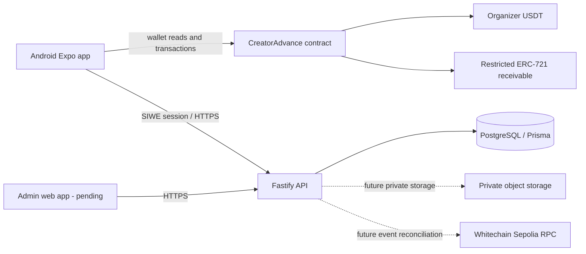

# CreatorAdvance architecture

**Status:** Local Android app, contract prototype, and API authentication/directory slices are implemented. Nothing is deployed. A live PostgreSQL migration, native Android build, and full-system wallet flow remain unverified.

## Product boundary

CreatorAdvance finances creator receivables. Whitechain Sepolia hosts USDT collateral, offers, funding, claim ownership, repayments, and default recovery. Mobile and API handle onboarding, private evidence, and directory workflows. The NFT represents an application claim; it is not a legal opinion that an assignment is enforceable. Use fictional demo businesses and test USDT only.

## Components

The implemented `CreatorAdvance` contract contains brand registration/status and signer roles, approved investors, per-brand collateral accounting, EIP-712 invoice confirmation, offer escrow, atomic funding and minting, restricted transfers, repayment fees, and default recovery. The API has a PostgreSQL schema/migration, SIWE nonce/session flow, current-user endpoint, and public active-brand directory.

## Lifecycle and authority

1. Platform verification is an offchain trust assumption. The business wallet registers and deposits USDT into its own collateral balance.
2. A creator selects a brand and creates an invoice. The API should keep documents private; only hashes and settlement fields are signed/onchain.
3. An authorized brand signer approves EIP-712 invoice details bound to the chain, contract, brand, invoice, creator, amount, due date, listing expiry, nonce, and deadline. Face-value collateral is reserved.
4. An approved investor escrows USDT in an offer. Creator acceptance transfers the price and mints a claim in one transaction.
5. Repayment reduces invoice outstanding once. The current eligible token holder receives each payment net of the configured fee. A transfer after a partial payment does not reassign prior distributions.
6. After maturity plus the grace period, any account can trigger default processing. Deposited collateral is applied to outstanding claim, the brand is frozen, and any remaining debt stays recorded. No external-wallet guarantee is implied.

## Trust boundaries and limitations

- Business verification, investor eligibility, legal assignment, invoice authenticity, and offchain recovery remain trust assumptions.
- The backend must not substitute its authority for creator or brand wallet authorization.
- Contract accounting and receipts are authoritative for financial state; the API database is an index/workflow store.
- PDFs and proof-of-delivery must never be public or stored onchain.
- API role-scoped write routes, private object storage, event reconciliation, and admin review are not implemented yet. The initial SQL migration is generated but has not been applied to a PostgreSQL server.
- Reown integration is configured in the app but needs an Android development build, project ID, external wallet, and real testnet wallet interaction.
- Public ETHGlobal information retrieved on Nov 6 did not show a submission deadline. `build.md` provides Nov 7, 2026 09:00 IST; verify it in the authenticated dashboard.
