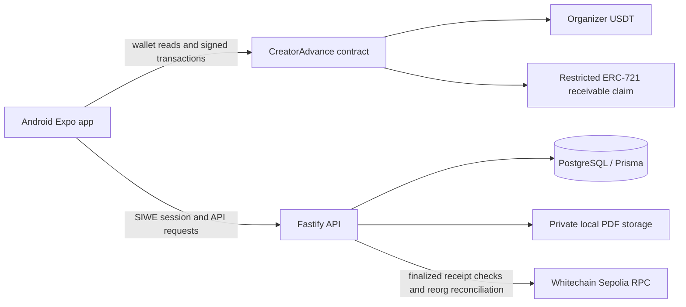

# CreatorAdvance architecture

**Current state:** local Android app, Fastify API, PostgreSQL schema, and contract lifecycle are implemented. The Android debug build is installed on the test phone. No contract is deployed and no live sponsor-USDT financing has been executed.

## Product boundary

CreatorAdvance finances creator receivables. Whitechain Sepolia is intended to hold USDT collateral, offers, financing, claim ownership, repayments, and default recovery. Mobile and API handle onboarding, private documents, brand directory, platform review, and chain event indexing. The ERC-721 represents an application claim; it does not prove a legally enforceable assignment. Use fictional demo businesses and test USDT only.

## Components

There is no separate web admin application; platform review is currently available through the mobile admin workspace. Private PDF storage is local to the API host and is not a production object-storage service.

## Contract authority and lifecycle

1. The platform administrator reviews business registration evidence offchain. The business owner registers the approved profile hash onchain, adds authorized signers, and funds its independently accounted USDT collateral.
2. A creator selects a brand from the directory and submits an invoice with private evidence. The brand signer approves the invoice fields using EIP-712; the API verifies the final receipt before treating it as financeable.
3. An approved investor escrows USDT in an offer. Creator acceptance atomically pays the creator and mints the claim to the investor. The contract allows transfer only to another allowlisted investor.
4. Repayment is sent to the current claim owner, net of the disclosed fee. Once overdue plus the grace period, the contract applies reserved collateral, freezes the brand, and records any remaining shortfall.
5. The API indexes finalized receipts and reconciles stored event block hashes so reorged data can be removed and projections rebuilt. Onchain state remains authoritative for financial transactions.

## Trust boundaries and limitations

- Business identity, invoice authenticity, investor suitability, legal assignment, and offchain recovery are not established by the chain.
- PDFs remain private offchain; only evidence hashes and financial state belong onchain.
- The contract admin can verify brands, manage investor eligibility, pause transfers, and update the fee recipient (subject to contract bounds). The current local demo maps a single test wallet to platform-admin status for development.
- The local API uses an isolated PostgreSQL cluster and a private filesystem directory. The cluster must be started after a machine restart; durable hosted services are not configured.
- The contract address is blank, deployment and source verification are pending explicit user approval, and the test wallet has no sponsor USDT.
- The wallet integration and Android build are verified locally, but wallet signing, app return flow, and live transaction approval still require a human on the connected phone.
- See [deployment preflight](DEPLOYMENT_PREFLIGHT.md), [blockers](BLOCKERS.md), and [test plan](TEST_PLAN.md).
